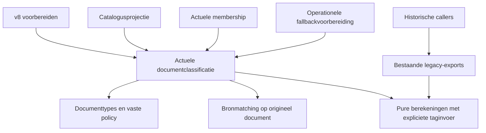

# Consistente actuele Reader-documentclassificatie

**Gepubliceerde specificatie:** [GitHub-issue #41](https://github.com/timoerlemans/top-articles/issues/41), label `ready-for-agent`.

## Doel en bevestigde scope

Kans 1 uit de architectuurreview: één deep module geeft locality aan de
interpretatie van Reader-documenten en leverage aan actuele scoring,
reekslidmaatschap en openbare catalogusprojectie.

De gebruiker heeft bevestigd: **bestaande classificatieregels consequent
toepassen, zonder nieuwe taxonomie of scoregewichten**. Dit document en het
bijbehorende implementatieplan zijn de gevraagde uitwerking; uitvoering volgt
na beoordeling van deze documenten.

De eerdere aanbevelingen voor gedeeld tagbehoud en de bevestigde Archive-workflow
zijn opgenomen in GitHub-issue
[#39](https://github.com/timoerlemans/top-articles/issues/39). Die uitvoering
maakt geen deel uit van dit ontwerp.

## Probleem en bewijs

`priority-membership.ts` breidt tags met canonieke aliassen uit.
`priority-topic-taxonomy.ts` en `core-interest-priority.ts` gebruiken andere
interpretaties. `build-data.ts` negeert descriptor-tags bij taal- en
interesseprojectie. Daardoor bestaat dezelfde documentkennis meerdere keren.

Een read-only reproductie met verder gelijke documenten geeft voor
`team collaboration` en `team dynamics & collaboration` beide
`social-studies`-lidmaatschap, maar fallback-relevantie 0 tegenover 4.
De topicscores zijn in die fixture 33 tegenover 93. Het verschil bevat zowel
topicrelevantie als kerninteressebewijs. Deze waarden beschrijven de
oorspronkelijke fout; toekomstige tests leggen de bestaande canonieke policy
en gelijkwaardige classificatie vast, niet een universele score van 93.

De bestaande historische modellen delen document-, judgment- en
kerninteressehelpers met v8. Een globale wijziging aan die helpers zou
historische vergelijkingen en bronmatching kunnen veranderen.

## Afgewogen interfaces

1. **Gekozen: één volledige actuele classificatie.** Callers krijgen
   samenhangende feiten, judgment-resolutie, topics en kerninteressebewijs
   achter één interface. De implementation verbergt interpretatie en volgorde.
2. **Alleen een tag-normalizer.** Kleinere interface, maar callers blijven
   membership, fallback, bewijs en publicatie zelf combineren: onvoldoende depth.
3. **Losse publieke interpretatie- en resolverfuncties.** Meer flexibiliteit,
   maar grotere interface en opnieuw volgordevoorwaarden bij callers. Er bestaat
   geen concrete behoefte aan verwisselbare classificatiepolicies.

De afhankelijkheden zijn **in-process**. Geen adapter, registry, transport,
globale cache of configureerbaar framework wordt toegevoegd. Kleine gedeelde
berekeningen mogen interne seams hebben; zij zijn geen nieuwe test surface
voor callers.

## Module en interface

Nieuw: `scripts/lib/reader-document-classification.ts`.

```ts
export interface ReaderDocumentClassification {
  readonly category: string;
  readonly language: "Nederlands" | "Engels" | "Frans" | null;
  readonly isDutch: boolean;
  readonly isBook: boolean;
  readonly isPdf: boolean;
  readonly readingMinutes: number | null;
  readonly interestTags: readonly string[];
  readonly tagDomains: readonly DirectDomain[];
  readonly sequences: readonly PrioritySequence[];
  readonly judgment: ContentJudgment;
  readonly judgmentSource: JudgmentSource;
  readonly topicRelevance: Readonly<Record<TopicSequence, TopicRelevanceResolution>>;
  readonly coreInterestMatches: readonly CoreInterestMatch[];
}

export interface ReaderClassificationOptions {
  readonly judgments?: PriorityJudgmentsConfig | Record<string, ContentJudgment>;
}

export function classifyReaderDocument(
  document: PriorityDocument,
  options?: ReaderClassificationOptions,
): ReaderDocumentClassification;

export function automatedReaderFallbackJudgment(
  document: PriorityDocument,
  judgedAt?: string,
): ContentJudgment;

export function readerClassificationFingerprintInput(): Record<string, unknown>;
```

Alle benoemde types komen uit de bestaande document-, sequence-, judgment- en
kerninteressemodules. Alleen de drie bovenstaande entrypoints vormen de
actuele classificatie-interface. Er zijn geen volgordevoorwaarden of writes.
Classificatie muteert geen invoer; zij levert een deterministische snapshot.
`automatedReaderFallbackJudgment` gebruikt dezelfde classificatie, aangevuld
met de bestaande operationele provenance en evidence van het originele document.

Onbekende tagwaarden worden voor classificatie genegeerd. Dat betekent nooit
dat een tagset volledig bekend is voor metadata-vervanging; die beslissing
blijft bij de uitvoering uit #39. Ontbrekende ID's en datums worden pas door
de bestaande exportvalidatie afgekeurd. Classificatie krijgt geen opslagkennis.

## Interpretatie en bestaande policy

- Ondersteun stringarrays, descriptorarrays en objectkeys. Een descriptor
  gebruikt `name ?? key` en telt alleen bij een stringwaarde. Objectmetadata
  wordt niet doorlopen; ook cyclische metadata blijft onschadelijk.
- Gebruik de bestaande normalisatie en `READWISE_TAG_ALIASES`. Bewaar onbekende
  inhoudstags. Een alias en zijn bestaande canonieke vervanging krijgen dezelfde
  inhoudelijke betekenis, ook bij een alias die naar meerdere tags uitbreidt.
- Bewaar originele gedecodeerde tagnamen intern naast canonieke betekenis.
  Positietags, taaltags en curatoriale signalen behouden hun afzonderlijke rol.
  Ze zijn geen inhoudelijk topic- of kerninteressebewijs. De bestaande
  `luchtig`-membershipcompatibiliteit met positietags blijft expliciet behouden.
- Membership en fallback-strength blijven afzonderlijke beslissingen binnen
  dezelfde implementation. Gebruik de bestaande tabellen, geen algemene regel
  `relevance > 0` of `strength === strong` voor alle topics.
- `team dynamics` en zijn canonieke tag: Scrum-relevantie 1, geen Scrum-reeks.
  `scrum`, `agile`, `team coaching`, `facilitation`, `flow & delivery` en
  `psm-ii`: bestaande sterke Agile-policy. Geen nieuwe membership-tags toevoegen.
- Filosofie behoudt zijn eigen ratings 4/3/2/1, verzadigingsregels, inhoudelijke
  signalen en uitsluiting van feedback/gegenereerde leesadviezen. Gebruik hiervoor
  de bestaande berekening met de gedeelde actuele taginterpretatie.
- Boeken horen uitsluitend in `boek`. PDF-excepties blijven gelijk.
  Contradictorische input zoals `category: video` plus `book` blijft door v8
  afgekeurd; de nieuwe classificatie mag die bestaande fout niet stil repareren.
- Actueel **Kort**: positieve leestijd `< 5`; `4.5 min` wel, `5 min` niet.
  Historische `< 10`-interpretatie blijft ongewijzigd.
- Expliciet Nederlands/Engels heeft voorrang op tags. Zonder zo'n expliciete
  taal gebruikt publicatie dezelfde Nederlandse herkenning als scoring;
  Nederlandse taaltags gaan vóór Engelse. Daarna blijven bestaande Engelse en
  Franse displaytags ondersteund. Zo ontstaat één consistente taalbeslissing.
- `tagDomains` bewaart de bestaande meervoudige tagafgeleide interessegebieden.
  `coreInterestMatches` bewaart primaire toewijzing van ambigue tags, semantische
  signalen en deduplicatie. `political philosophy` kan meerdere zichtbare
  interessegebieden hebben, maar levert het bestaande primaire scorebewijs.
  Aliasuitbreiding vermenigvuldigt geen bonus voor dezelfde kerninteresse.
- Kerninteressebewijs vermeldt de originele genormaliseerde brontag;
  aliassen kunnen daarom verschillende bewijslabels hebben bij dezelfde
  interesse en score. Canonieke betekenis mag niet als extra onafhankelijke
  bron worden geteld.

`front-end software development` staat in de verrijkingstaxonomie, maar niet
in de huidige membership/fallbacktabellen. Deze wijziging voegt die tag niet
als nieuw membership toe; een dergelijke policywijziging vraagt apart werk.

## Judgments, fingerprints en historische isolatie

Valideer en match een opgeslagen judgment **altijd met het originele document**.
Een actuele accepted semantische beoordeling blijft leidend, inclusief expliciete
topicrelevantie `0`. Een ontbrekend topicveld gebruikt de actuele fallback.
Draft/rejected/stale beoordelingen worden niet als geldige labels gebruikt.

Een operationele beoordeling met `AUTOMATED_FALLBACK_JUDGER` is geen semantisch
label. Bereken deterministische ratings en topics opnieuw uit de actuele
classificatie; behoud toepasselijke provenance en `confidence: low`. Dit
voorkomt dat een oude opgeslagen fallback de aliasfout blijft vastzetten.
Classificatie schrijft deze herberekening niet terug naar config.

`judgmentSourceFingerprint`, `judgmentMatchesSource`, `buildPriorityEvidence`,
hun serialization en legacy-matching blijven ongewijzigd. Bereken source- en
evidencehashes nooit uit canoniek herschreven `doc.tags`. Een alias en een
canonieke tag mogen verschillende sourcehashes behouden.

Behoud de bestaande exports van `judgmentFor`, `fallbackJudgment`,
`automatedFallbackJudgment`, `topicRelevanceFor`, `resolveCoreInterestMatches`
en `historicalSequencesForDocument` voor historische callers. Waar pure
berekeningen gedeeld worden, geven legacy-exports hun oorspronkelijke invoer
door; de actuele classificatie levert haar eigen interpretatie. Shared helpers
importeren de nieuwe classifier niet: zo blijft de importgrafiek acyclisch.

Historische v2/v3/v5/v6/v7-uitvoer en historische kanten van impactrapporten
blijven exact gelijk. V8 blijft werken zonder historische scoringmodules.
De bestaande curatoriale/auteursbonussen, handmatige overrides, clipping,
tiers, tie-breaks en descriptor-curatiequirks vallen buiten deze correctie.
Issue #35 kan die auteursregels later wijzigen; deze wijziging neemt dat niet over.

## Integratie en locality



V8 classificeert eenmaal per voorbereid document en gebruikt dezelfde uitkomst
voor globale fallback, topicrelevantie, taal, leestijd, kerninteressebewijs en
membership. Gewichten, aggregatie, componentrekenen, correcties en ranking
blijven in v8 en de bestaande kerninteresse-aggregatie.

De actuele `sequencesForDocument` delegeert; `historicalSequencesForDocument`
blijft zelfstandig. Scan actuele posities altijd uit originele tags, zonder
deduplicatie: dubbele positietags moeten hun bestaande fout blijven geven.

Verplaats de bestaande openbare itemprojectie uit `build-data.ts` naar
`scripts/lib/catalog-item.ts`: dezelfde sanitization en privacyregels, maar
classificatiefeiten uit de nieuwe module. Deze module concentreert openbare
projectie, niet alleen een doorgeefaanroep. De build houdt ophalen, lijstbouw,
configvalidatie en bestandswrites.

Voeg classificatiebeleidsinvoer toe aan de bestaande sourceFingerprint van
prioriteitstag-, algemene Archive- en lees-Archiveplannen. Die invoer bevat een
versie en de daadwerkelijk gebruikte alias-/membership-/relevance-/interesse-
regels. De ongewijzigde ruwe document- en judgmenthashes staan daarvan apart.
Een plan van vóór deze wijziging vraagt een nieuwe voorbereiding/bevestiging.
Geen nieuwe bevestigingsflow wordt geïntroduceerd.

## Test surface en voltooiing

De interface is de test surface: vaste verwachte classificaties, v8-uitvoer en
openbare catalogusitems. Geen tests op private helperstructuur of broncodevorm.
Historische contracttests blijven behouden; alleen redundante actuele
helpertests mogen vervallen na equivalente dekking.

Bewijs alias/representatiegelijkheid, niet-stapeling, ontbrekende velden,
taalconflicten, books-only, tegenstrijdige video/boek-input, tijdgrenzen,
filosofiesignalen, semantische nulratings, operationele fallbacks, raw fingerprints,
invoerimmutabiliteit, positieconflicten, privacy en historische isolatie.

Vaste baselinewijzigingen worden per document en veld verklaard. Geen massale
snapshotvervanging. Gewijzigde v8-scores door herstelde classificatie en nieuwe
onderhoudsplanhashes zijn verwacht; historische resultaten en bronhashes niet.

Verifieer betrokken tests en daarna `npm run check`. Gebruik fixtures, geen
live Reader-opvraag, mutatie of e-mail. `data/data.js` en `data/score.js` blijven
onaangetast tijdens implementatie; actuele publicatie volgt later via de
bestaande `npm run build`-route. ADR-0001 blijft ongewijzigd.
